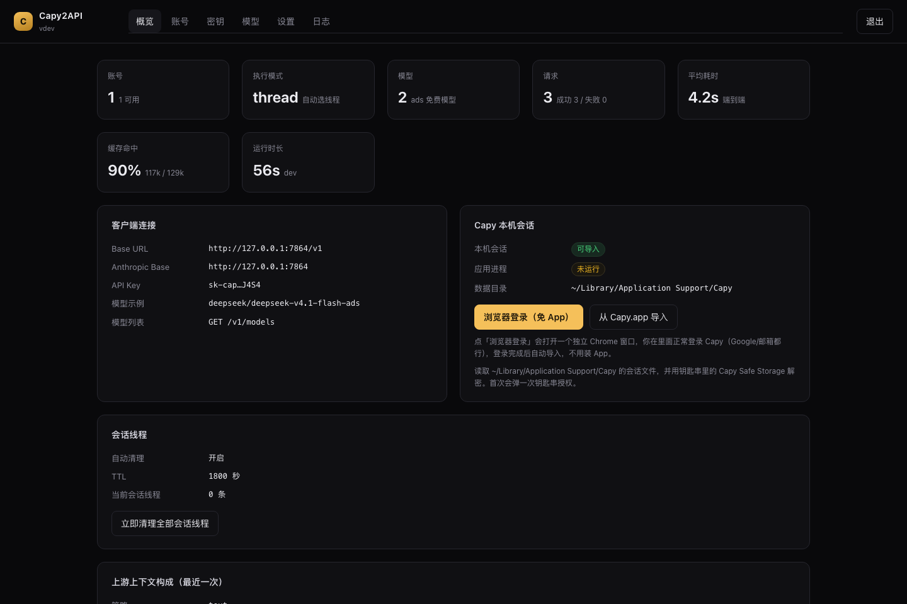
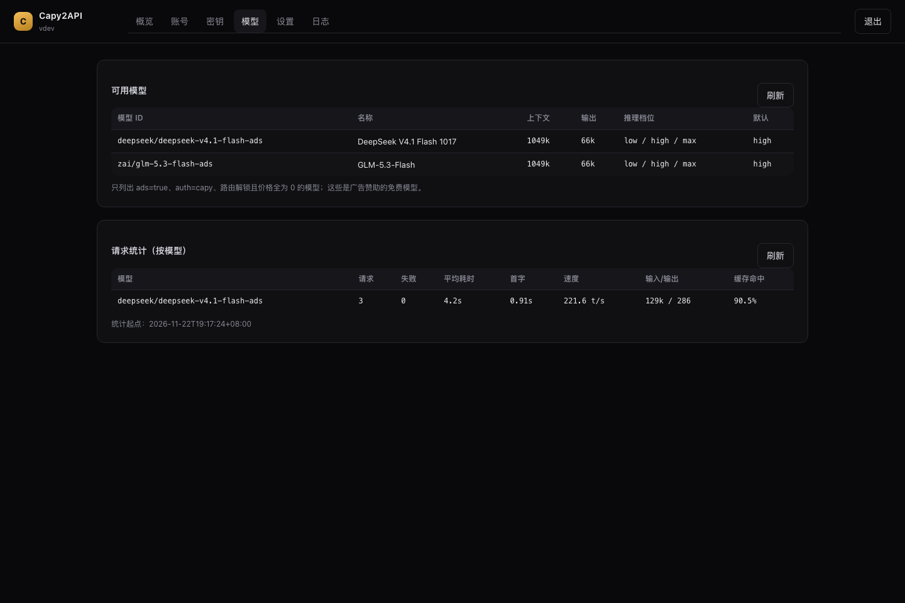
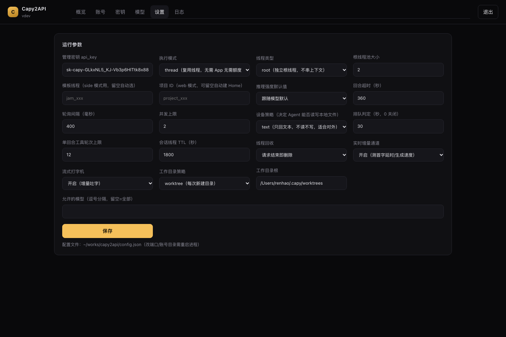

# capy2api

[](LICENSE)
[](go.mod)
[](.github/workflows/ci.yml)

把 **Capy（capy.ai）** 的免费广告模型，转成 **OpenAI / Anthropic 兼容的 API**。
不需要启动 Capy 桌面端，不需要云端额度，一个二进制 + 浏览器登录即可。

> 供学习与自用研究。使用前请自行确认符合上游服务条款。

## 界面预览







## 特性

- **双协议**：`/v1/chat/completions`（OpenAI）、`/v1/messages`（Anthropic）、`/v1/responses`（Codex）
- **零 App**：浏览器登录 → 自动注册设备 → 网关自建隧道跑回合
- **工具调用**：客户端声明 tools，模型出 `tool_calls`，由客户端执行（读文件/写文件/跑命令/MCP 都在客户端）
- **流式**：正文增量 + 思考过程（`reasoning_content` / `thinking` 块）
- **会话复用**：同一段对话固定一条上游线程，prompt cache 命中 ~99%
- **多租户**：API key 配额（请求数/token）、RPM、并发、模型白名单、账号绑定
- **可观测**：首字延迟、生成速度、缓存命中、上下文构成、上游工具调用记录
- **自带面板**：账号、密钥、模型、设置、日志、一键清理线程

## 快速开始

### 方式一：下载二进制

从 Releases 下载对应平台的文件，直接运行：

```bash
chmod +x capy2api-darwin-arm64
./capy2api-darwin-arm64
```

### 方式二：源码构建

```bash
git clone https://github.com/<you>/capy2api
cd capy2api
go build -o capy2api ./cmd/server
./capy2api
```

首次启动会生成 `config.json` 并打印管理密钥。打开面板：

```
http://127.0.0.1:7864/panel/
```

### 导入账号

面板 →「账号」→「浏览器登录（免 App）」：会打开独立 Chrome 窗口，正常登录 Capy 即可，网关自动抓取会话并注册设备。

## 客户端接入

### Claude Code（Anthropic 协议）

```bash
export ANTHROPIC_BASE_URL=http://127.0.0.1:7864
export ANTHROPIC_API_KEY=sk-capy-...
claude -p "读取 README.md 并总结"
```

模型名不认识也没关系，网关会自动回退到可用的 ads 模型。

### DSH / Cursor / 任意 OpenAI 兼容客户端

```bash
export OPENAI_BASE_URL=http://127.0.0.1:7864/v1
export OPENAI_API_KEY=sk-capy-...
```

DSH 的 provider 配置见 [`examples/dsh-headless-patch.yml`](examples/dsh-headless-patch.yml)。

### 直接调用

```bash
curl http://127.0.0.1:7864/v1/chat/completions \
  -H "authorization: Bearer $KEY" -H "content-type: application/json" \
  -d '{"model":"deepseek/deepseek-v4.1-flash-ads","messages":[{"role":"user","content":"你好"}]}'
```

## 工具是怎么工作的

```
客户端（Claude Code / DSH / Cursor）
  │ 发送 messages + tools
  ▼
网关：把工具定义写进提示词，要求模型输出 JSON 决策
  ▼
模型：{"kind":"tool_calls","calls":[{"name":"Read","arguments":{"path":"a.txt"}}]}
  ▼
网关：翻译成标准 tool_calls 返回
  ▼
客户端执行工具（读文件/写文件/跑命令/MCP）
  ▼
客户端把结果发回 → 模型继续 → 最终回答
```

**文件读写和 MCP 都在客户端完成**，网关只负责协议转换，不碰你的磁盘。

## 设备策略（Agent 能否读本地文件）

| `device_policy` | 能力 | 适用 |
| --- | --- | --- |
| `text`（默认） | 只回文本，Agent 不能读写 | 对外提供 API |
| `readonly` | Agent 可读工作区、只读命令白名单 | 单机自用 |
| `all` | 读写 + 任意命令 | 仅限自己机器 |

## 配置

完整字段见 [`config.example.json`](config.example.json)，常用：

```jsonc
{
  "listen": "127.0.0.1:7864",
  "api_key": "sk-capy-...",
  "capy": {
    "mode": "thread",              // thread | web | device
    "thread_mode": "root",         // root=独立线程；side=子线程（继承上下文）
    "max_concurrent": 2,           // 同一账号并发回合数，建议 1-2
    "turn_timeout_sec": 360,
    "conversation_ttl_sec": 1800,  // 会话线程存活时间
    "device_policy": "text",
    "queue_timeout_sec": 30,       // 首字超时判定为排队
    "max_tool_steps": 12
  }
}
```

## 性能与限制

- 正常首字 **0.3–1.5 秒**，生成 **180–350 tok/s**
- 同一账号并发 ≥3 会被上游排队（首字固定 ~90 秒）；建议并发 ≤2
- 长代码任务单轮可能生成上万 token，耗时可到数分钟
- 线程会自动清理（默认 30 分钟 TTL），也可在面板一键清理

## 安全提示

- `config.json` 与 `auths/` 含账号凭据，已在 `.gitignore` 中排除
- 对外提供服务时保持 `device_policy=text`，避免 Agent 触碰宿主机
- 记忆（AGENTS.md）是 **账号级** 的，多租户请一 key 一账号
- 不要把管理密钥提交到仓库或分享给他人

## 目录结构

```
cmd/server/          入口（serve / login / import / accounts / models）
internal/capy/       Capy 上游客户端：线程、事件、实时通道、工具协议
internal/capyapp/    从 Capy.app 读取设备凭据（可选）
internal/devicedaemon/ 自建「设备」：隧道 + invoke 处理
internal/server/     HTTP 网关：OpenAI / Anthropic / Responses / 面板 API
internal/panel/      内置面板（HTML/CSS/JS，go:embed）
internal/store/      账号、密钥、日志持久化
examples/            客户端接入示例
```

## License

MIT
